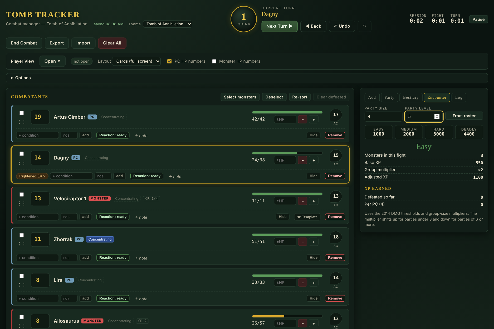
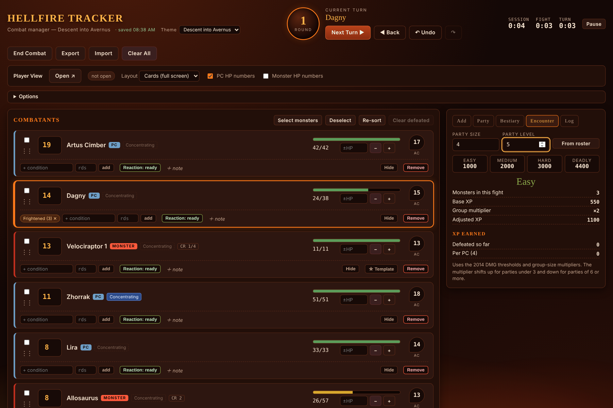
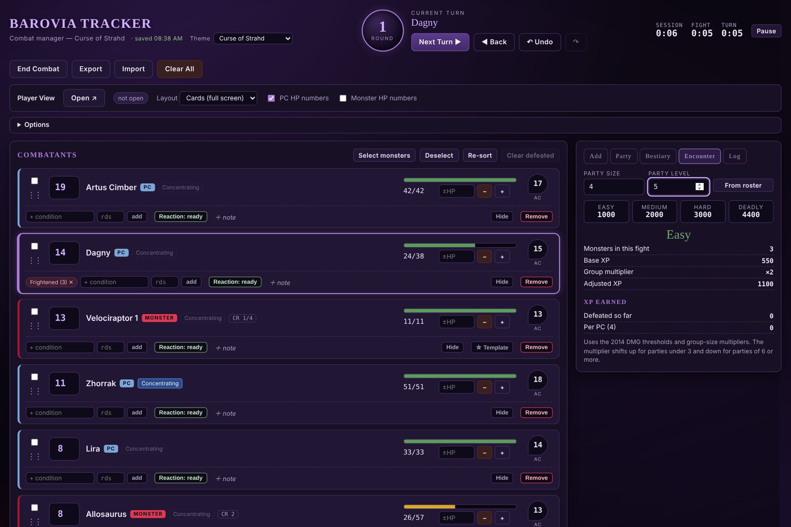
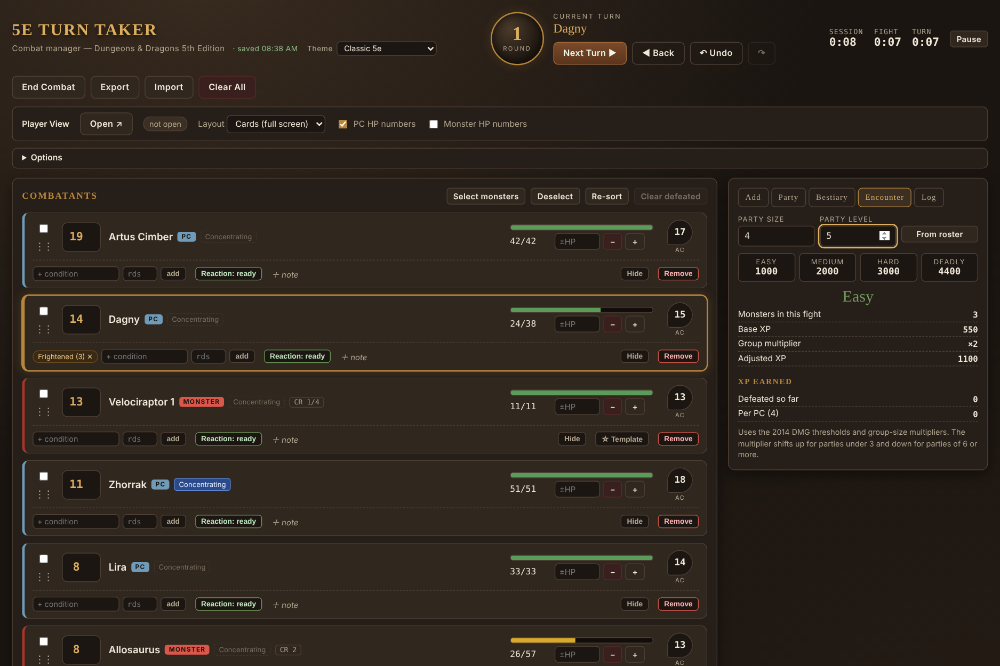
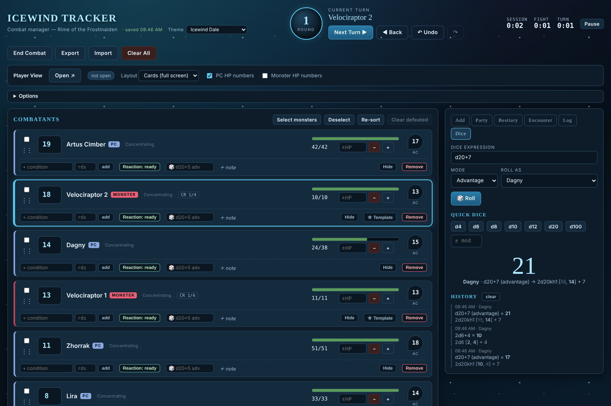
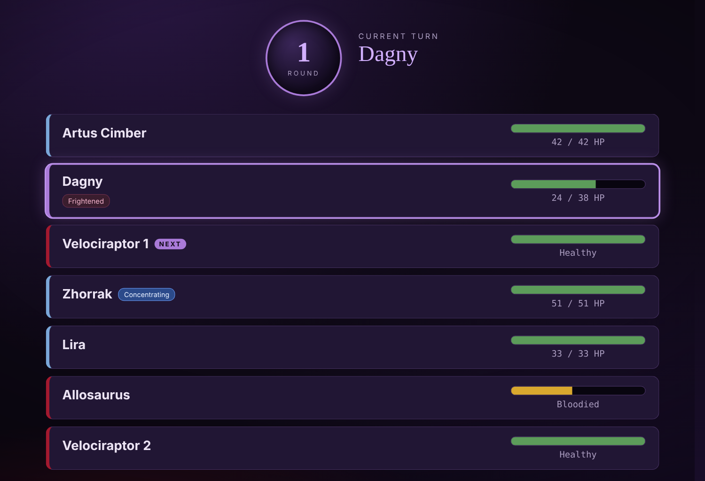

# 🐉 5e Turn Taker

**A fast, single-file combat tracker for in-person D&D 5e (2014 rules).**
Run it on the DM's screen. Show a spoiler-free view to the table.

---

## Why

Running combat at a table with a projector or TV means juggling initiative, HP, conditions, concentration and timers, while the players must not see AC, hidden monsters or DM notes. Turn Taker keeps all the bookkeeping on your screen and gives the table a clean, read-only window.

Built by a DM running *Tomb of Annihilation* with Foundry VTT on a laptop and projector, but it works for any 2014-rules 5e game, with a theme for the campaign you are running.

## Quick start

**Fastest:** open the live app at **https://capslock-numlock.github.io/5eTurnTaker/** and bookmark it. Nothing to install.

**Offline, for game night:** download [`index.html`](index.html) once and keep it on your laptop.

1. Double-click the file. It opens in Edge, Chrome or any modern browser.
2. Add combatants (or load your party and the Bestiary), press **Start Combat**, then **Open ↗** in the Player View bar and drag that window to the projector.

No installation, no build step, no account. Fonts load from Google Fonts when online and fall back to system fonts offline.

> **Tip:** double-click anywhere in the player window for full screen.

## Themes

Pick a theme from the dropdown next to the title. The choice is saved, and the player window follows it automatically. The app name, subtitle, browser-tab title and icon change with the theme, and so do the sounds (see below).

| Theme | App name | Look |
| --- | --- | --- |
| **Tomb of Annihilation** (default) | Tomb Tracker | Jungle green and gold |
| **Descent into Avernus** | Hellfire Tracker | Lava and embers, with a slow hellfire glow along the bottom edge |
| **Curse of Strahd** | Barovia Tracker | Dark purple with gothic lettering and a drifting-fog vignette |
| **Classic 5e** | 5e Turn Taker | Neutral brown leather and bronze |
| **Icewind Dale** | Icewind Tracker | Ice blue, a slow aurora and drifting snow |

HP colors (green, amber, red) stay the same in every theme so health is always readable at a glance. Animations respect the system "reduce motion" setting.

## Dice roller

The **Dice** tab is a full roller for the DM, and every roll is also written to the combat log.

- Expressions: `d20+5`, `2d6+3`, `4d6kh3`, `2d8+1d4-2`, `d%`
- Advantage and disadvantage from a dropdown, or just add `adv` / `dis` to the expression (`d20+7 adv`)
- Quick buttons for d4 to d100 with a modifier box, and a "Roll as" picker so results are credited to a creature
- Natural 20 and natural 1 are highlighted; dropped dice are struck through
- Every combatant card has its own roll box: type `d20+5 adv`, press Enter, and the result pops up as that creature. The box remembers the roll so you can hit Enter again for the next attack
- Roll history: click any entry to roll it again

## Sounds

Turn changes, the turn timer, dice rolls, natural 20s and natural 1s all have sound effects, synthesized live in the browser (no audio files, so the app stays a single file). **Each theme has its own voice:**

| Theme | Sound |
| --- | --- |
| Tomb of Annihilation | Wooden marimba, stone knocks, skin drum |
| Descent into Avernus | Infernal horns, tritones, crackling fire |
| Curse of Strahd | Tolling church bell, harpsichord, organ chord |
| Classic 5e | Tavern ding, wooden dice, brass flourish |
| Icewind Dale | Glass pings, ice cracks, howling wind |

Sounds play from the DM window (browsers only allow audio after you click something). Switch them off or change the volume in **Options**, where a Test button plays a sample.

## Features

### Running combat
- Initiative order with DEX tie-breaks, and drag-to-reorder for delayed or readied actions
- Round counter plus session, fight and per-turn clocks, with an optional turn timer and buzzer
- Turns follow the creature, not the list position, so adding or removing combatants mid-round is safe
- Skips defeated monsters and dead PCs automatically (optional)
- Lair actions on initiative 20

### Hit points and effects
- Type damage straight into a card: `-12` damage, `+5` heal, `t8` temp HP, `=20` set HP
- Group damage: select several creatures, then apply full, half, double or no damage to each (saves, resistance, vulnerability)
- Conditions with 2014 PHB rules text on hover, and round durations that expire on their own
- Concentration tracking with an automatic **CON save DC** prompt on every hit
- Reaction tracker, legendary action pips and recharge abilities (d6 prompts at the start of a turn)
- Death saves with Nat 20 and Nat 1 buttons, massive-damage instant death

### Prep and bookkeeping
- Party roster: save your PCs once; HP carries over between fights; long-rest button
- Monster bestiary: editable templates with dice-based HP and a Tomb of Annihilation starter set
- Add many at once ("Velociraptor ×4"), with rolled or average HP, individual or shared initiative
- Hidden monsters: add or reveal them whenever you like
- Encounter difficulty and XP calculator using the 2014 DMG thresholds and group multipliers
- Dice roller with advantage, keep-highest and per-creature rolls
- Combat log, exportable as text; per-fight stats for the session
- Unlimited undo / redo, autosave, JSON export and import

### Player view
- Separate window with **no** AC, notes, lair actions, hidden monsters or condition timers
- HP as a health bar with Healthy / Injured / Bloodied / Critical labels, or real numbers (separate toggles for PCs and monsters)
- Cards layout for a full screen, or a slim **ribbon** you can dock along the edge of the map
- Matches the DM's chosen theme (sound stays on the DM's side)
- "Next up" preview, current-turn flash, optional chime and visible turn timer

## Keyboard shortcuts

| Key | Action |
| --- | --- |
| `Space` / `Enter` | Next turn (when not typing in a field) |
| `Ctrl` + `Z` | Undo |
| `Ctrl` + `Y` | Redo |
| `Esc` | Deselect / close dialog |
| `Enter` in an HP box | Apply the typed command |

## Data and privacy

Everything stays in your browser. Combat state, roster and monster templates are kept in `localStorage`; nothing is sent anywhere. Use **Export** to back up a session or move it to another computer, and **Import** to restore it.

## Rules coverage

Implements the **2014** 5e rules: DMG encounter thresholds and multipliers (levels 1-20), PHB conditions, concentration DC = max(10, damage ÷ 2), death saves and massive damage, legendary actions regained at the start of the creature's turn.

Bestiary starter stats are entered by hand from the 2014 Monster Manual and may contain errors. Check them against your book; every template is editable.

## Browser support

Current Chrome and Edge are tested. Firefox and Safari should work; the player window relies on pop-ups, so allow them for the page. Opening from `file://` is supported.

## Contributing

Issues and pull requests are welcome. The whole app lives in `index.html`: styles, markup and one script. There is nothing to compile.

## License

[MIT](LICENSE)
